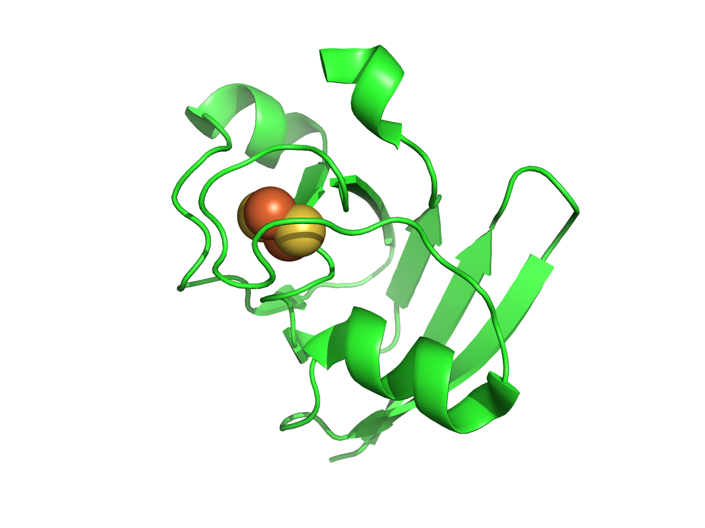
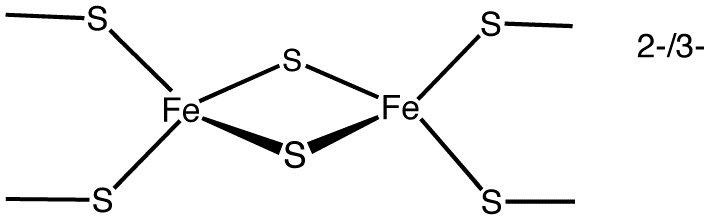
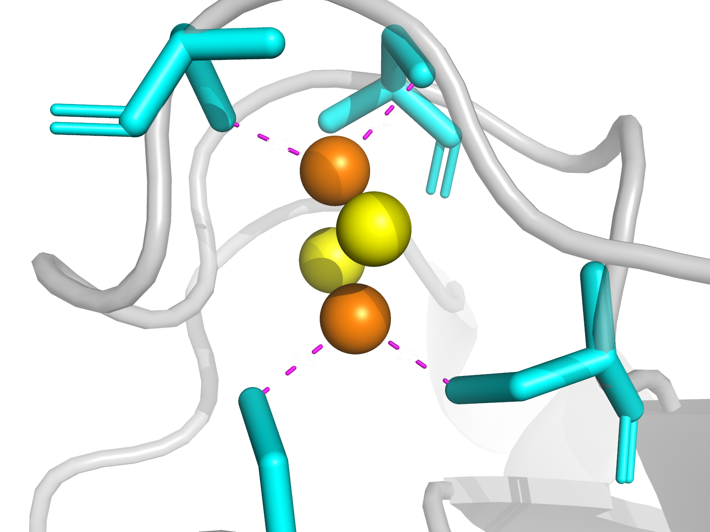

# De Novo Fe–S Protein Design

Computational design of novel iron–sulfur (Fe–S) binding proteins using generative structural models and protein language models.

## Overview

This project explores the de novo design of protein scaffolds capable of accommodating iron–sulfur clusters. Fe–S clusters are important biological cofactors involved in electron transfer, catalysis, and other essential cellular processes.

The goal is to develop a computational pipeline that generates novel protein structures around specified Fe–S coordination motifs, designs compatible amino acid sequences, and evaluates the resulting candidates for structural and chemical plausibility.

This work serves as an initial foundation for investigating more unconventional metal–sulfur architectures, including proposed nickel–sulfur structures associated with electron transport in cable bacteria.

## Biological Background

Iron–sulfur clusters consist of iron atoms coordinated with inorganic sulfide ions and surrounding amino acid residues, commonly cysteine.

Two common cluster types include:

- **[2Fe–2S]:** Two iron atoms and two inorganic sulfide ions.
- **[4Fe–4S]:** Four iron atoms and four inorganic sulfide ions arranged approximately in a cubane-like geometry.

These clusters can support electron transfer through reversible changes in their oxidation states. Their function depends on both the cluster's chemical properties and the surrounding protein environment.

### Reference Protein Structure



### Extracted Fe–S Coordination Motif




## Computational Design Pipeline

The pipeline combines structural motif extraction, backbone generation, sequence design, and computational validation.

```text
Experimental Fe–S Protein Structures
                 |
                 v
       Fe–S Motif Extraction
                 |
                 v
    Coordination Geometry Analysis
                 |
                 v
    RFdiffusion Backbone Generation
                 |
                 v
     ProteinMPNN Sequence Design
                 |
                 v
       ESM Sequence Analysis
                 |
                 v
   AlphaFold / ColabFold Validation
                 |
                 v
    Geometry Evaluation & Ranking
                 |
                 v
      Candidate Fe–S Proteins
```

**1. Motif extraction:** Identify Fe–S clusters and their coordinating residues from experimentally determined protein structures.

**2. Backbone generation:** Use RFdiffusion to generate novel protein scaffolds conditioned on selected structural constraints.

**3. Sequence design:** Use ProteinMPNN to generate amino acid sequences compatible with the resulting backbones while preserving critical binding-site residues.

**4. Sequence analysis:** Use ESM protein language models to extract representations and evaluate sequence characteristics.

**5. Structural validation:** Use AlphaFold/ColabFold predictions and geometry-based analysis to assess fold plausibility, motif preservation, and candidate quality.

Predicted structural compatibility does not establish actual Fe–S binding or electron-transfer function. Experimental characterization would be required to validate these properties.

## Designed Protein Structures

*Placeholder: Side-by-side comparison of an experimentally determined reference structure and a generated protein scaffold.*


*Placeholder: Close-up comparison of the intended Fe–S coordination motif and its geometry in a selected designed scaffold.*


## Project Organization

```text
configs/       Model parameters and experiment configurations
data/          Reference structures and processed Fe–S motifs
src/           Preprocessing, generation, prediction, and scoring
scripts/       Command-line pipeline utilities
notebooks/     Exploratory analysis and visualization
experiments/   Experiment configurations and results
outputs/       Generated structures, sequences, and predictions
cluster/       GPU cluster configurations and Slurm scripts
docs/          Documentation and figures
tests/         Validation and unit tests
```

## Computational Tools

| Tool | Role |
|---|---|
| BioPython / Gemmi | Protein structure parsing and motif extraction |
| RFdiffusion | De novo protein backbone generation |
| ProteinMPNN | Structure-conditioned sequence design |
| ESM-2 | Protein sequence representations and analysis |
| AlphaFold / ColabFold | Structure prediction and validation |
| PyTorch | Deep learning inference |
| PyMOL | Molecular visualization |

#References:
Approximate Structural Values for 2Fe-2S: [The competition between chemistry and biology in assembling iron–sulfur derivatives](https://www.sciencedirect.com/science/article/abs/pii/S0010854514002082)